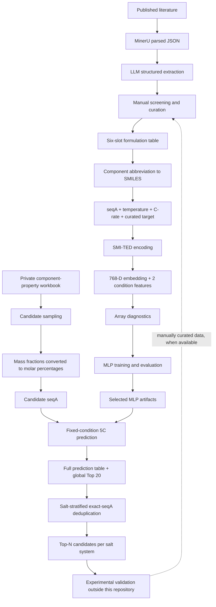

# Research workflow

## Scope

This repository contains code for literature extraction, formulation preparation, molecular representation, MLP training, candidate generation and prediction. It does not distribute the curated literature database, private experimental records or component-property workbooks.

The computational workflow ends with ranked candidate tables. Experimental validation and the curation of new experimental results are performed outside this repository. No automatic experiment-to-training feedback routine is currently implemented here.

## Pipeline overview

The diagram shows the implemented computational stages and the external experimental step. The dotted arrow is a possible manual research update, not an automated software feature.

## Stage-by-stage guide

| Stage | Code | Main input | Main output | Important boundary |
| --- | --- | --- | --- | --- |
| Literature extraction | `LLM_code/extract_literature.py` | MinerU JSON files | Parsed CSV and skeleton JSON files | Extraction is not final curation; rate-performance values require manual checking. |
| Composition conversion (optional) | `ML_code/preprocessing/Unify.py` | Original composition workbook and property workbook | `Unified_mole_ratio` column | This helper does not itself create the six-slot model input table. |
| SMILES mapping | `ML_code/preprocessing/replace.py` | Six-slot composition workbook and property workbook | SMILES-mapped workbook | Unmatched component labels must be checked. |
| Sequence construction | `ML_code/preprocessing/smiles_integrate.py` | Six component slots, molar fractions, conditions and curated target | `seqA,T_C,Rate_C,y_retention` CSV | Input `*_mol_pct` values are fractions from 0 to 1; the writer multiplies them by 100. |
| Molecular encoding | `ML_code/encode_fastcharge_embeddings.py` | Sequence CSV and SMI-TED checkpoint | `X_fastcharge_data.npy`, `y_fastcharge_data.npy` | Feature order is embedding, temperature, C-rate; 768 + 2 = 770 features. CSV row order is preserved. |
| Array diagnostics | `ML_code/check_npy.py` | X and y arrays | Console diagnostics | Matching row counts alone do not prove record-level pairing. |
| Model training | `ML_code/train_mlp.py` | X and y arrays | Timestamped training outputs and MLP artefacts | The split is record-level, not grouped by publication or formulation. |
| Candidate generation | `ML_code/generate_candidates.py` | Component workbook with SMILES and molecular weights | Candidate CSV with mass fractions and `seqA` | Sampling uses mass fractions; sequence composition is expressed as molar percentages. Recent-window deduplication is not global deduplication. |
| Fixed 5C inference | `ML_code/predict_5c.py` | Candidate CSV, SMI-TED checkpoint and selected MLP artefacts | Full prediction CSV, global Top 20 and run-information JSON | Uses 25 °C and 5C for every row. |
| Alternative inference | `ML_code/predict_default.py` | Candidate CSV, SMI-TED checkpoint and selected MLP artefacts | Full prediction CSV, Top 20 and run information | Uses row-wise conditions where available; otherwise defaults to 25 °C and 4C. Its default output filenames are reused, so set a distinct output directory for each run. |
| Salt-stratified selection | `ML_code/postprocessing/select_topn_by_salt.py` | Full prediction CSV with score, `seqA`, `salt1` and `salt2` | One ranked CSV per salt system, summary CSV and run JSON | Exact `seqA` string deduplication is performed within each salt group; the highest-scoring duplicate is retained. |

## Recommended execution order

### A. Build the curated training dataset

1. Parse literature PDFs with MinerU outside this repository and place the resulting JSON files in a local input directory.
2. Configure the API key locally and run the LLM extraction script.
3. Screen the extracted records, resolve duplicates and verify electrode pairing, test conditions and capacity ratios.
4. Prepare the six-slot composition table and property workbook.
5. Run the SMILES mapping and sequence-construction scripts.
6. Confirm the target is a ratio such as `0.721`, not a percentage such as `72.1`.
7. Encode sequences and inspect the resulting arrays before training.

### B. Train and select the model

1. Run `ML_code/train_mlp.py` with the intended X/y arrays.
2. Inspect the saved train, validation and test metrics and error tables.
3. Record the training run directory and its run metadata.
4. Promote the selected model, scaler and feature-index files together to `ML_code/models/final/` only after review. Update `ML_code/models/final/artifacts.json` with the new checksums and provenance. Do not mix artefacts from different training runs.

### C. Generate and screen candidates

1. Prepare the private component workbook required by `generate_candidates.py`.
2. Generate candidate sequences and retain the original generator output.
3. Run `predict_5c.py` with the selected MLP and matching SMI-TED checkpoint.
4. Run the salt-stratified post-processing script on the full prediction table, not on the already truncated Top 20 table.
5. Inspect per-salt counts, score distributions and representative formulations before choosing experimental candidates.

## Data and interpretation cautions

- The LLM extraction output is a starting point for curation, not a verified training dataset.
- The scripts pass the curated target through; they do not calculate the capacity ratio from raw cycling data.
- Missing temperature and rate values may be filled with defaults by the encoding scripts. Keep defaults distinguishable from reported experimental conditions.
- The format-only file in `data/examples/` is not an experimental formulation or a model-validation result.
- Candidate generation and model prediction are computational prioritisation steps. They do not establish experimental performance.
- Preserve the complete prediction table and run-information JSON for every screening run. A Top-N table alone is insufficient to reconstruct the screening process.
